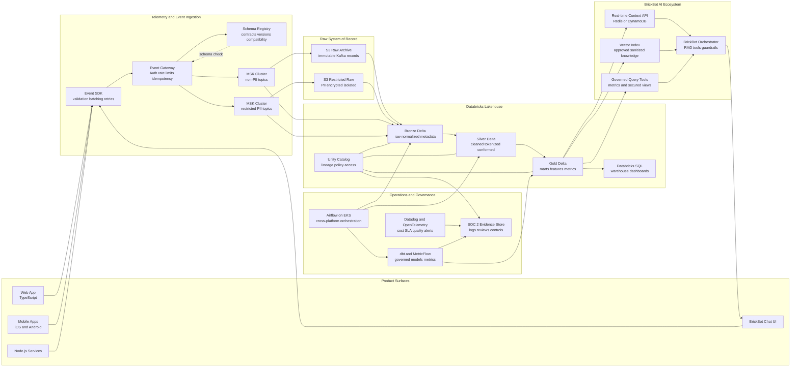
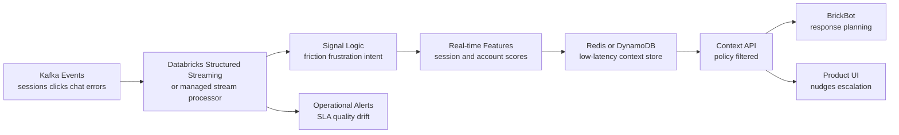
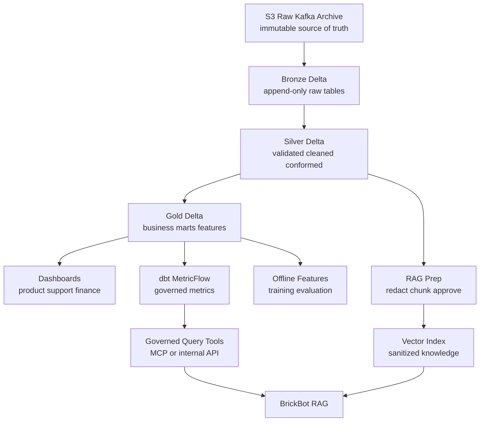
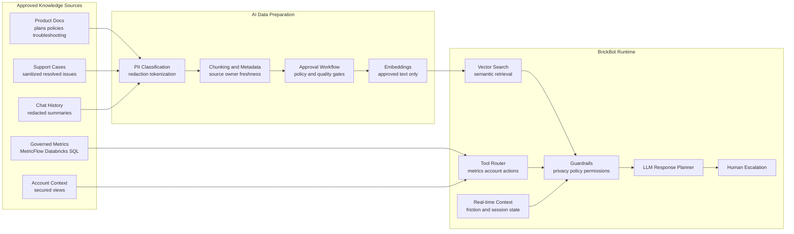
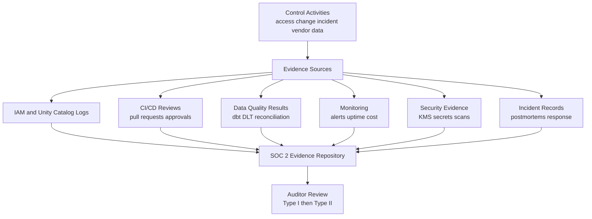

# Brick Phone Wireless: Data Architecture and AI Ecosystem

## Executive Summary

Brick Phone's Wireless product serves small business owners and modern independent workers who need reliable connectivity, account support, and business-aware service plans. The data platform should help product teams move fast while giving BrickBot, Brick Phone's AI support and collaboration agent, enough governed context to provide useful, trustworthy assistance.

This proposal uses a Databricks-first lakehouse on AWS:

- Kafka/MSK is the streaming transport and short-term replay buffer.
- S3 is the durable system of record for raw events and long-term archives.
- Databricks, Spark, Delta Lake, Delta Live Tables, and Databricks SQL provide the core data engineering, analytics, and AI data platform.
- dbt and MetricFlow define governed transformations and business metrics.
- Airflow on Amazon EKS orchestrates cross-system workflows where Databricks Jobs alone are not enough.
- BrickBot uses a split AI context model: low-latency behavioral signals from the hot path plus sanitized long-term knowledge from a governed RAG pipeline.
- SOC 2 readiness is designed into the architecture from day one through access controls, encryption, lineage, audit logs, data contracts, monitoring, and evidence collection.

The result is intentionally pragmatic. Brick Phone gets a scalable foundation without prematurely operating a separate warehouse, a separate ML platform, and a large set of custom AWS-native data services.

## Goals and Assumptions

### Goals

- Capture reliable product, mobile, web, chat, billing, and support telemetry.
- Support real-time BrickBot reactions to customer friction, frustration, failed flows, and account context.
- Preserve raw Kafka streams in S3 for replay, audit, backfills, and model training.
- Provide trusted analytics for product, support, finance, customer success, and leadership.
- Feed BrickBot with privacy-safe retrieval and governed metrics.
- Keep early-stage costs predictable while leaving a clear path to scale.
- Build toward SOC 2 Type I and Type II readiness.

### Baseline Assumptions

| Area | Assumption |
| --- | --- |
| Company stage | Early to growth-stage startup with a small but senior data team |
| Event volume | Starts in the low millions of events per day, designed to scale to hundreds of millions |
| Data growth planning | Plan for telemetry and retained analytical data to grow 30% to 40% annually, with quarterly capacity reviews |
| Latency needs | Sub-second to seconds for application context, minutes for dashboards, hours for deep historical jobs |
| Cloud | AWS primary cloud |
| Primary platform | Databricks lakehouse on AWS |
| Data retention | 5 years queryable in S3/Delta, older raw archives in lower-cost archival storage |
| Data sensitivity | Small business owner data includes PII, billing context, support messages, and potentially sensitive business metadata |
| Warehouse strategy | Databricks SQL is the v1 warehouse layer; no separate warehouse unless future scale requires it |

## High-Level Architecture



## Why Databricks Over Native AWS

A fully AWS-native platform is possible, but it would require stitching together many separate services: MSK or Kinesis, S3, Glue, EMR, Athena, Redshift, SageMaker, Lake Formation, OpenSearch, Step Functions, MWAA, and custom governance logic. That can work at a larger company with dedicated platform teams. For Brick Phone, the better v1 choice is a Databricks lakehouse on AWS.

| Decision Area | Databricks Lakehouse | Fully AWS-Native Alternative | Recommendation |
| --- | --- | --- | --- |
| Streaming and batch processing | One Spark-based platform for streaming, batch, and Delta Live Tables | MSK/Kinesis plus Glue/EMR plus multiple job frameworks | Use Databricks to reduce operational glue |
| Reliable lake storage | Delta Lake gives ACID transactions, schema evolution, time travel, and replayable pipelines | S3 plus Glue tables plus custom table maintenance or Iceberg/Hudi operations | Use Delta Lake as the default table format |
| Warehouse needs | Databricks SQL supports BI dashboards and analytical marts | Redshift or Athena with additional governance and performance tuning | Avoid a separate warehouse in v1 |
| Data science and AI | MLflow, notebooks, feature engineering, model workflows, vector search, and model serving are integrated | SageMaker plus Glue/EMR plus custom feature store and vector tooling | Use Databricks for faster AI iteration |
| Governance | Unity Catalog centralizes lineage, permissions, table discovery, row filters, and column masks | Lake Formation, IAM, Glue, Redshift permissions, and custom policy alignment | Use Unity Catalog as the data governance control plane |
| Startup cost and speed | Fewer platforms to hire for, secure, and operate | More services with more integration points | Choose Databricks now, keep AWS primitives underneath |

AWS still remains critical. S3, MSK, IAM, KMS, EKS, CloudWatch, VPC networking, private endpoints, and archival storage are core infrastructure. The decision is not Databricks instead of AWS; it is Databricks as the unified data and AI layer on top of AWS.

## Ingestion and Telemetry Strategy

### Event Capture

Brick Phone should standardize telemetry through lightweight client and server SDKs:

- Web: TypeScript SDK for app interactions, account actions, plan flows, and chat UI behavior.
- Mobile: native or cross-platform SDK wrappers for app events, session context, device metadata, offline buffering, and retry.
- Backend: Node.js services emit authoritative domain events for billing, provisioning, plan changes, support routing, and account lifecycle.
- BrickBot: chat messages, tool calls, retrieval decisions, escalation events, and user feedback are emitted as first-class events.

The SDK should enforce:

- Required envelope fields.
- Local schema validation before publish where practical.
- Event batching and backoff.
- Idempotency keys.
- Offline queueing for mobile.
- Sampling controls for high-volume diagnostic events.
- Explicit user consent and privacy flags where required.

### Event Gateway

Clients should not publish directly to Kafka. Events flow through an authenticated event gateway:

1. Verify app identity, user/session token, and tenant/account context.
2. Validate event envelope and schema version.
3. Apply rate limits and bot/abuse controls.
4. Attach server-side metadata such as `received_at`, IP-derived coarse geography, gateway version, and request id.
5. Route to the correct Kafka/MSK cluster and topic based on domain and sensitivity.

This keeps mobile and web clients simple while allowing the ingestion layer to evolve.

### Kafka/MSK Topic Strategy

Kafka is the transport layer, not the permanent archive. It should retain enough history for operational replay, but S3 is the durable source of truth.

| Stream Class | Example Topics | Cluster | Retention | Notes |
| --- | --- | --- | --- | --- |
| Product usage | `product.app_interaction.v1`, `product.session.v1` | Non-PII MSK | 3 to 14 days | High-volume behavior events |
| Support and BrickBot | `support.chat_event.v1`, `bot.tool_call.v1` | Mixed, routed by sensitivity | 7 to 14 days | Raw messages may be restricted |
| Domain events | `billing.invoice_event.v1`, `wireless.plan_change.v1` | Non-PII or restricted | 7 to 30 days | Backend authoritative events |
| Restricted PII | `restricted.customer_identity.v1`, `restricted.chat_message_raw.v1` | Restricted MSK | Short retention | Separate ACLs, KMS keys, and audit logs |
| Operational telemetry | `ops.pipeline_event.v1`, `ops.quality_check.v1` | Non-PII MSK | 7 days | Pipeline monitoring and evidence |

For the earliest stage, Brick Phone can run two MSK clusters: one standard cluster and one restricted cluster for PII-heavy workloads. If cost pressure is severe, the interim step is one cluster with isolated topics, ACLs, KMS keys, and network controls, but the target SOC 2-ready architecture should preserve a strong separation boundary for restricted streams.

### Raw Kafka Streams in S3

Every Kafka stream should be continuously copied to S3 before transformation. This raw archive protects the company from consumer bugs, schema mistakes, accidental table corruption, and future training/backfill needs.

Recommended raw layout:

```text
s3://brick-data-raw-nonpii/kafka/
  topic=product.app_interaction.v1/
  ingest_date=2026-05-11/
  ingest_hour=14/
  partition=00003/
  part-000000.snappy.parquet

s3://brick-data-raw-restricted/kafka/
  topic=restricted.chat_message_raw.v1/
  ingest_date=2026-05-11/
  ingest_hour=14/
  partition=00001/
  part-000000.snappy.parquet
```

Each raw record should preserve:

- Kafka topic, partition, offset, key, timestamp, and headers.
- Event payload exactly as received after gateway enrichment.
- Schema id and schema version.
- Gateway request id and ingestion timestamp.
- Producer app, SDK version, and source platform.

MSK Connect, Kafka Connect S3 Sink, or Amazon Data Firehose can write these records to S3. Kafka retention can remain short and cost-effective because S3 becomes the replayable archive.

## Hot Path: Real-Time BrickBot Context

BrickBot needs fresh context when a customer is stuck. The hot path turns event streams into compact, low-latency signals that the application can use immediately.



### Real-Time Signals

Examples of computed signals:

| Signal | Inputs | Use |
| --- | --- | --- |
| Checkout or plan flow friction | Repeated page views, validation errors, abandoned steps | BrickBot offers targeted help |
| Support frustration | Negative sentiment, repeated messages, rapid retries, escalation keywords | Escalate to human or adjust tone |
| Provisioning risk | Failed device activation, API errors, delayed carrier response | Trigger proactive support |
| Confusing feature | High help-open rate after a UI action | Product analytics and in-app guidance |
| Account health | Recent failed payments, plan changes, support volume | Context for BrickBot and customer success |

### Serving Pattern

The real-time store should contain only compact derived features, not raw sensitive content. Example record:

```json
{
  "account_id": "acct_123",
  "session_id": "sess_456",
  "last_updated_at": "2026-05-11T14:23:00Z",
  "friction_score": 0.82,
  "friction_reasons": ["activation_failed", "repeated_help_open"],
  "active_flow": "device_activation",
  "recommended_action": "offer_activation_walkthrough",
  "ttl_seconds": 3600
}
```

BrickBot reads these signals through a context API that applies authorization, tenant isolation, and privacy filtering before returning data to the LLM orchestration layer.

## Cold Path: Lakehouse, Analytics, and Historical AI Data

The cold path converts raw events into trusted, queryable, documented data products.



### Bronze

Bronze tables preserve raw events in Delta with standardized metadata:

- Append-only ingestion from raw S3 archives and selected direct Kafka streams.
- Minimal parsing to expose envelope fields.
- No destructive cleanup.
- Bad records quarantined to error tables with clear failure reasons.
- Delta time travel enabled for replay and incident analysis.

### Silver

Silver tables make data usable and safer:

- Deduplicate by `event_id` and source metadata.
- Enforce schema compatibility.
- Normalize timestamps and account identifiers.
- Tokenize or hash user identifiers.
- Apply PII classification and column masking.
- Run Delta Live Tables expectations and dbt tests.
- Publish conformed dimensions such as account, plan, user, device, session, and support case.

### Gold

Gold tables are product-facing data products:

- Product funnel and activation marts.
- BrickBot conversation quality and escalation marts.
- Support operations marts.
- Wireless plan lifecycle and retention marts.
- Billing and revenue analytics.
- Account health features.
- Governed semantic metrics through dbt MetricFlow.

Databricks SQL should serve dashboards directly in v1. A separate warehouse can be revisited later if there is a strong need for workload isolation, external customer-facing analytics, or non-Databricks enterprise BI constraints.

## BrickBot RAG and AI Ecosystem

BrickBot should not be a generic chatbot connected directly to raw data. It should be an orchestrated AI system with controlled retrieval, real-time context, policy filters, observability, and human escalation.



### Retrieval Design

BrickBot has three context sources:

1. Real-time context from the hot path: current session, active flow, friction score, and recommended intervention.
2. Long-term RAG knowledge: approved docs, support resolutions, sanitized summaries, and troubleshooting procedures.
3. Governed structured data: account status, plan details, billing state, and business metrics through secured query tools.

These sources should remain separate at runtime. Real-time context should be fetched through a low-latency API. RAG retrieval should search only approved vector indexes. Structured data should flow through governed tools that enforce tenant isolation and column-level restrictions.

### RAG Update Loop

- Product and support docs are indexed after approval.
- Resolved support cases become candidate knowledge after PII redaction and quality review.
- BrickBot conversations are summarized before training or retrieval use.
- User feedback, deflection rate, escalation rate, and answer quality are measured in gold marts.
- Model and retrieval changes are evaluated offline before production rollout.

### AI Privacy Principles

- Do not embed raw PII unless there is a documented exception and a strict access boundary.
- Prefer summaries, tokens, hashes, and aggregate patterns over raw messages.
- Keep raw chat content in restricted storage with short operational access windows.
- Log prompts, retrieval ids, tool calls, and response metadata for audit, but avoid storing unnecessary sensitive prompt payloads.
- Red-team the assistant for data leakage, cross-tenant access, and unsafe support actions before broad release.

## Privacy, Security, and Governance

### Data Classification

| Classification | Examples | Storage and Access |
| --- | --- | --- |
| Public | Marketing content, public help docs | Standard S3 and vector index |
| Internal | Aggregated product metrics, non-sensitive operational data | Lakehouse with role-based access |
| Confidential | Account health, plan usage, support metadata | Unity Catalog controls, audit logging |
| Restricted PII | Name, email, phone number, billing details, raw chat content | Separate Kafka cluster, restricted S3 bucket, KMS isolation, column masks |

### PII Strategy

- Separate PII and non-PII streams at ingestion.
- Use different Kafka clusters or strongly isolated topic namespaces, depending on stage and cost.
- Use separate S3 buckets and KMS keys for restricted data.
- Tokenize direct identifiers before data reaches common silver and gold layers.
- Use secured views for role-specific access.
- Prevent raw restricted fields from entering BrickBot prompts or embeddings by default.
- Maintain a PII inventory connected to data contracts and Unity Catalog tags.
- Support deletion and retention workflows for privacy obligations.

### Access Control

- AWS IAM roles should be least privilege and environment-specific.
- Databricks Unity Catalog should control table, view, row, and column access.
- Service accounts should be scoped by workload.
- Production data access should require approval and be logged.
- Break-glass access should be time-bound and reviewed.
- Secrets should live in AWS Secrets Manager or Databricks secret scopes backed by cloud-native secret management.

## SOC 2 Readiness Path

Brick Phone should design the platform so SOC 2 evidence is produced as a side effect of normal operations. The architecture should align to the AICPA Trust Services Criteria: Security, Availability, Processing Integrity, Confidentiality, and Privacy. Reference: [AICPA SOC 2 Trust Services Criteria](https://www.aicpa-cima.com/topic/audit-assurance/audit-and-assurance-greater-than-soc-2).



### Control Mapping

| Trust Service Criteria | Architecture Support | Evidence |
| --- | --- | --- |
| Security | IAM, KMS, private networking, Unity Catalog, least privilege, code review | Access reviews, audit logs, encryption settings, pull requests |
| Availability | Job retries, autoscaling, dashboard SLAs, incident response, backup/replay from S3 | Datadog alerts, uptime reports, runbooks, incident records |
| Processing Integrity | Schema Registry, data contracts, Delta Live Tables expectations, dbt tests | Test results, failed quality checks, reconciliation reports |
| Confidentiality | Restricted buckets, PII isolation, column masks, secured views, secrets management | Policy configs, access logs, key rotation records |
| Privacy | PII inventory, retention policies, deletion workflows, AI redaction controls | Data maps, deletion tickets, retention jobs, RAG approval logs |

### Phased Certification Path

| Phase | Timeframe | Focus | Outcome |
| --- | --- | --- | --- |
| Phase 1 | Platform build | Implement SOC 2-ready foundations with controls and logs | Controls exist by design |
| Phase 2 | Readiness | Perform gap assessment and remediate missing evidence | Audit scope and control matrix are clear |
| Phase 3 | Type I | Validate that controls are designed appropriately at a point in time | SOC 2 Type I report |
| Phase 4 | Type II | Operate controls consistently over the audit window | SOC 2 Type II report |

## Cost and Operational Pragmatism

### Cost Controls

- Use S3 lifecycle policies: 5 years readily available, older raw archives moved to Glacier Instant Retrieval, Glacier Flexible Retrieval, or Deep Archive depending on access needs.
- Keep Kafka retention short because raw streams are archived in S3.
- Use Databricks job clusters for scheduled workloads and auto-terminate interactive clusters.
- Apply cluster policies for instance families, maximum workers, Photon usage, spot instances where appropriate, and idle termination.
- Separate dev, staging, and production workspaces or catalogs with stricter production controls.
- Monitor cost by team, pipeline, cluster, catalog, and workload tag in Datadog and cloud billing exports.
- Use incremental dbt models and Delta optimizations rather than full refreshes by default.
- Reserve always-on compute only for truly low-latency services such as the context API.
- Reforecast Kafka partitions, S3/Delta storage, Databricks job clusters, and dashboard warehouse capacity quarterly against the 30% to 40% annual data-growth planning assumption.

### Observability

Key dashboards:

- Ingestion lag by topic, partition, and consumer group.
- Raw archive freshness and write failures.
- Bronze, silver, and gold table freshness.
- Data quality pass/fail trends.
- BrickBot retrieval quality, escalation rate, and user feedback.
- Cost per pipeline and cost per business domain.
- PII access and restricted table query audit.
- SOC 2 control evidence completeness.

## Spec-Driven Development for Events

Every new event should be defined before engineering work begins. The event contract is reviewed by product, engineering, data, security/privacy, and the downstream owner.

```mermaid
flowchart LR
  REQ["Product or Engineering Need"] --> RFC["Event RFC\npurpose owner consumers"]
  RFC --> CONTRACT["Data Contract\nschema PII retention"]
  CONTRACT --> REVIEW["Review\nproduct data privacy security"]
  REVIEW --> REG["Schema Registry\nversion compatibility"]
  REG --> SDK["SDK Implementation\nclient or service"]
  SDK --> TEST["Contract Tests\nsample payloads CI"]
  TEST --> PROD["Production Publish"]
  PROD --> MONITOR["Quality Monitoring\nfreshness volume errors"]
  MONITOR --> DOCS["Catalog Docs\nlineage metrics owner"]
```



### Event Contract Template

```yaml
event_name: product.app_interaction
event_version: 1
owner: product_analytics
business_purpose: Track important app interactions for activation, usability, and BrickBot context.
producer: web_app
classification: internal
pii_fields: []
retention:
  kafka_days: 7
  s3_queryable_years: 5
  archive_after_years: 5
downstream_consumers:
  - activation_funnel_mart
  - brickbot_realtime_context
  - product_usage_dashboard
compatibility: backward
quality_checks:
  - event_id is required and unique
  - occurred_at must be within 24 hours of received_at
  - account_id is required for authenticated events
  - interaction_name must be in approved enum
fields:
  event_id:
    type: string
    required: true
    description: Globally unique id generated by the SDK for idempotency.
  event_name:
    type: string
    required: true
    description: Stable event name.
  event_version:
    type: integer
    required: true
    description: Contract version for compatibility checks.
  occurred_at:
    type: timestamp
    required: true
    description: Time the interaction occurred on the client.
  received_at:
    type: timestamp
    required: true
    description: Time assigned by the event gateway.
  account_id:
    type: string
    required: true
    description: Brick Phone account id.
  user_id_hash:
    type: string
    required: false
    description: Hashed user identifier. Raw user id is not emitted in this event.
  session_id:
    type: string
    required: true
    description: Client session id.
  source:
    type: string
    required: true
    description: Producer surface, such as web, ios, android, or api.
  properties:
    type: object
    required: true
    description: Event-specific attributes.
```

### Example Payload

```json
{
  "event_id": "evt_01HXYZ",
  "event_name": "product.app_interaction",
  "event_version": 1,
  "schema_version": "product.app_interaction.v1",
  "occurred_at": "2026-05-11T14:22:03Z",
  "received_at": "2026-05-11T14:22:04Z",
  "account_id": "acct_123",
  "user_id_hash": "sha256:7a38...",
  "session_id": "sess_456",
  "source": "web",
  "properties": {
    "screen": "device_activation",
    "interaction_name": "activation_help_opened",
    "flow_step": "carrier_verification",
    "sdk_version": "2.4.0"
  }
}
```

## Example Data Products

| Data Product | Users | Freshness | Source Layer |
| --- | --- | --- | --- |
| Activation funnel dashboard | Product and leadership | 15 minutes | Gold |
| BrickBot quality mart | Support, AI, product | 15 minutes to hourly | Gold |
| Account health feature table | BrickBot, customer success | 5 minutes to hourly | Gold plus hot path |
| Support escalation mart | Support operations | 15 minutes | Gold |
| Governed revenue metrics | Finance and leadership | Daily, with selected intraday metrics | Gold and MetricFlow |
| RAG knowledge index | BrickBot | On approved content change | Sanitized docs and summaries |

## Implementation Roadmap

### First 30 Days

- Define event envelope, event contract template, and review process.
- Stand up event gateway, Schema Registry, and initial MSK topics.
- Create raw S3 archive for all Kafka streams.
- Create Databricks workspace, Unity Catalog, bronze ingestion, and basic monitoring.
- Implement core app interaction, session, support chat, and plan lifecycle events.

### Days 31 to 60

- Build silver conformance for account, session, plan, support, and BrickBot events.
- Build first gold marts and Databricks SQL dashboards.
- Add dbt tests, MetricFlow definitions, and Airflow orchestration for cross-system jobs.
- Launch real-time context store for BrickBot friction signals.
- Start PII inventory, data retention policy, and access review process.

### Days 61 to 90

- Build sanitized RAG pipeline for product docs and support resolutions.
- Add secured query tools for BrickBot account and metric access.
- Add cost dashboards and cluster policies.
- Run SOC 2 readiness gap assessment.
- Formalize incident response, change management, access reviews, and evidence storage.

## Key Tradeoffs

- Databricks over AWS-native services reduces integration complexity, but Brick Phone should still keep cloud primitives portable: S3 raw archives, open table formats, Terraform/IaC, and clear data contracts.
- Kafka is not long-term storage. Short retention is acceptable because S3 preserves raw records and Kafka metadata for replay.
- Separate restricted infrastructure for PII costs more, but it reduces blast radius and makes SOC 2, privacy, and AI controls easier to explain.
- BrickBot should start with retrieval and tools, not direct autonomous writes. Human escalation and policy controls should come before broad automation.
- A separate warehouse is deferred. Databricks SQL is sufficient until workload isolation, latency, or customer-facing analytics needs justify another platform.

## Final Recommendation

Brick Phone should build a Databricks-centered lakehouse on AWS with durable raw Kafka archives in S3, strong PII separation, governed semantic metrics, and a BrickBot RAG pipeline that uses approved knowledge plus real-time behavioral context. This design balances speed and safety: it supports fast product iteration now while creating the control surface, auditability, and privacy posture needed for a future SOC 2 certification path.
